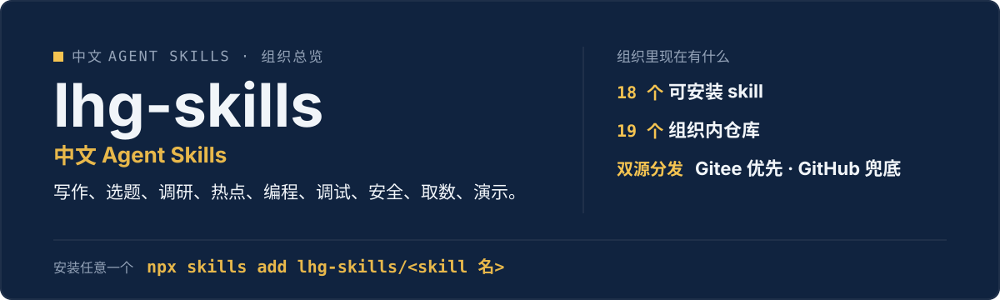

  

# lhg-skills · 中文 Agent Skills

> **lhg-skills 是一套为中文用户打造的开源 Agent Skills**：写作、选题、调研、热点、编程、调试、安全、联网取数、演示文稿、UI 走查——开箱即用，一键安装。

刘洪光（安徽合肥）出品，MIT 开源。每个 skill 都是“流程 + 方法论 + 自检机制”的完整工作流，不是 prompt 集合。组织内现有 18 个可安装 skill + 1 门学习课程（lhg-study-methods）+ 本总览仓，共 19 个仓库。

## 怎么安装（推荐：发给 Agent）

把下面这段话里的 `<skill 名>` 换成下表中的名称（例如 `lhg-writing`），整段发给你的 Agent（豆包 / WorkBuddy / Claude Code / Codex / Cursor 等）：

> 请帮我安装 Skill「`<skill 名>`」：先从 Gitee 上 lhg-skills 组织下的 `<skill 名>` 仓库下载；如果 Gitee 无法访问或下载失败，改从 GitHub 上 lhg-skills 组织下的同名仓库下载。按当前 Agent 的规范安装其中的 Skill，优先全局安装，保留完整目录和依赖。请直接执行，完成后验证是否安装成功，告诉我实际使用的来源、安装的版本号以及如何调用；遇到访问或安装限制请说明具体原因。

国内用户默认从 Gitee 镜像下载，打不开时自动改用 GitHub。只是打开了仓库网页不算安装，Agent 报出版本号才算装好。

能访问 GitHub、会用命令行时，也可以直接：`npx skills add lhg-skills/<skill 名>`

分发规范见 [SKILL-DISTRIBUTION.md](SKILL-DISTRIBUTION.md)。

## Skills 矩阵

| Skill | 一句话 | 开发者安装 |
|---|---|---|
| [lhg-writing](https://github.com/lhg-skills/lhg-writing) | 风格指纹 → Orwell 六规则 → AI 味诊断，写出有人味的中文 | `npx skills add lhg-skills/lhg-writing` |
| [lhg-slides](https://github.com/lhg-skills/lhg-slides) | 大纲/文档一键生成可编辑的单文件 HTML slides | `npx skills add lhg-skills/lhg-slides` |
| [lhg-feynman-teach](https://github.com/lhg-skills/lhg-feynman-teach) | 费曼四步讲通，再做成讲稿即旁白的教学视频（默认 3 分钟） | `npx skills add lhg-skills/lhg-feynman-teach` |
| [lhg-wb-bluebook](https://github.com/lhg-skills/lhg-wb-bluebook) | WorkBuddy 实战知识库：问一句怎么做，就告诉你读哪章、按哪几步做 | `npx skills add lhg-skills/lhg-wb-bluebook` |
| [lhg-trend](https://github.com/lhg-skills/lhg-trend) | 话题火不火、为什么火、还能不能追 | `npx skills add lhg-skills/lhg-trend` |
| [lhg-deep-research](https://github.com/lhg-skills/lhg-deep-research) | 多源检索 → 热度排名 → 作者深挖 → 结构化中文调研报告 | `npx skills add lhg-skills/lhg-deep-research` |
| [lhg-benchmark-topic-factory](https://github.com/lhg-skills/lhg-benchmark-topic-factory) | 找对标 → 逆向 100 条选题库 → 口播文案 | `npx skills add lhg-skills/lhg-benchmark-topic-factory` |
| [lhg-net](https://github.com/lhg-skills/lhg-net) | 中文优先多平台取数，取不到诚实说 | `npx skills add lhg-skills/lhg-net` |
| [lhg-craft](https://github.com/lhg-skills/lhg-craft) | 分级澄清 → TDD → 独立评审 → 证据门禁 | `npx skills add lhg-skills/lhg-craft` |
| [lhg-debug](https://github.com/lhg-skills/lhg-debug) | 复现 → 定位 → 修复 → 验证 | `npx skills add lhg-skills/lhg-debug` |
| [lhg-secure](https://github.com/lhg-skills/lhg-secure) | 九维度扫描 + 对抗验证，分级风险清单 | `npx skills add lhg-skills/lhg-secure` |
| [lhg-finder](https://github.com/lhg-skills/lhg-finder) | 装第三方 skill 前的 blocker 检查 + 六维评分 | `npx skills add lhg-skills/lhg-finder` |
| [lhg-ui-review](https://github.com/lhg-skills/lhg-ui-review) | 截图/代码/链接三输入，五支柱走查找缺点并给可执行修复意见 | `npx skills add lhg-skills/lhg-ui-review` |
| [lhg-soul-transfer](https://github.com/lhg-skills/lhg-soul-transfer) | 把你在 AI 那里的“灵魂 + 记忆”打包进私有仓，换机器/换平台 10 分钟让新 agent 认识你 | `npx skills add lhg-skills/lhg-soul-transfer` |
| [lhg-refund](https://github.com/lhg-skills/lhg-refund) | 先判四要素再选路径，12 平台专属话术与人工申请模板 | `npx skills add lhg-skills/lhg-refund` |
| [lhg-antigravity-chinese](https://github.com/lhg-skills/lhg-antigravity-chinese) | Google Antigravity Windows/macOS 双平台汉化：兼容性预检、四项冒烟全过才报完成 | `npx skills add lhg-skills/lhg-antigravity-chinese` |
| [lhg-share-github](https://github.com/lhg-skills/lhg-share-github) | 把 GitHub 项目合规放到 Gitee 分享：先核许可，再导入，不冒充原创 | `npx skills add lhg-skills/lhg-share-github` |
| [lhg-idea](https://github.com/lhg-skills/lhg-idea) | 收藏链接、项目、博主，按需求检索自己的收藏（lhg-idea skill 的存储后端） | `npx skills add lhg-skills/lhg-idea` |
| [lhg-study-methods](https://github.com/lhg-skills/lhg-study-methods) | DBS 全体系学习课程：边学边录视频讲解（课程仓库，非 skill） | 课程仓库，从第 0 讲读起 |

> lhg-study-methods 是课程仓库（非 skill，没有 `npx skills add` 安装方式，从第 0 讲读起）；lhg-idea 是个人收藏库，同时是 `lhg-idea` skill 的存储后端。本仓（lhg-skills）是组织总览仓，不是一个 skill。

## 按场景选

- **做自媒体内容**：lhg-trend 找热点 → lhg-benchmark-topic-factory 拆对标出选题 → lhg-writing 写稿 → lhg-slides 做演示 → lhg-feynman-teach 把知识点讲成教学视频
- **调研一个新领域**：lhg-deep-research 出结构化调研报告；想学一套商业方法论，去 lhg-study-methods 上 8 讲课
- **写代码做工程**：lhg-craft 定规范 → lhg-debug 修 bug → lhg-secure 做安全审计
- **给 AI 装技能**：lhg-net 提供联网取数能力，lhg-finder 在装第三方 skill 前把质量关
- **换机器 / 换平台**：lhg-soul-transfer 把灵魂 + 记忆打包进两个私有仓，10 分钟让新 agent 认识你
- **退费 / 分享**：lhg-refund 先判四要素再走渠道；lhg-share-github 把 GitHub 项目合规放到 Gitee 分享

## 分发规范（摘要）

完整规范见 [SKILL-DISTRIBUTION.md](SKILL-DISTRIBUTION.md)。核心就六条：

1. **按最差环境设计**：假设用户打不开 GitHub、Agent 会拦截 `npx`、会在微信里乱点链接、分不清「打开网页」和「装好了」。
2. **Agent 代办优先于人工教程**：分发的是一段「发给 Agent 的指令」，不是「教用户操作的步骤」。
3. **一份话术适配所有 Agent**：用「按当前 Agent 的规范安装」把平台差异交给 Agent 自己处理，不为每个平台单独写教程。
4. **安装 → 验证 → 教学 → 报错，闭环写全**：装完必须自检、告诉用户怎么用；失败必须说清具体原因。
5. **双源分发：Gitee 优先，GitHub 兜底**：GitHub 是唯一源头（source of truth），Gitee 是自动同步的镜像。
6. **人机分工写死**：密码、付费、删除等操作必须停下来等用户亲手完成，写进 SKILL.md。

## 姊妹组织

刘洪光的其他组织：

| 组织 | 定位 |
|---|---|
| [lhg-skills](https://github.com/lhg-skills) | 中文 AI Agent Skills（你在这里） |
| [lhg-projects](https://github.com/lhg-projects) | 产品项目仓：开源工具 + 孵化中项目 |
| [lhg-x](https://github.com/lhg-x) | X 内容运营：做技术、一边做技术一边卖服务 |
| [lhg-plugs](https://github.com/lhg-plugs) | 小白专家插件市场：86 个一句话调用的垂直领域插件 |

skill 用顺手了，去 lhg-plugs 找一句话插件；想做产品，去 lhg-projects 看开源工具；想看日常动态，去 lhg-x 跟进 X 账号。

## 常见问题

**这些 skill 能用在哪些 Agent 上？**
纯 Markdown 流程描述，不依赖特定平台：Claude Code、Codex、豆包、Workbuddy 等支持 Markdown 指令的环境都可用。

**和 awesome 列表里的英文 skill 有什么区别？**
中文优先：中文写作指纹、中文互联网取数、中文内容选题——英文 skill 覆盖不到的场景。

**一定要有 Gitee 吗？**
不需要。Gitee 是 GitHub 的国内镜像，内容自动同步，只是为了让打不开 GitHub 的用户也能装上。

**怎么给 skill 提问题或建议？**
每个仓库 README 底部有自检与反馈机制，欢迎提 issue。

组织内 15 个 skill 仓库带有 LICENSE 文件；lhg-idea、lhg-share-github、lhg-study-methods 与本仓目前没有单独的 LICENSE 文件。

## 关注

- 抖音：搜「刘老师讲AI实战」
- 全部 skill 开源在 https://github.com/lhg-skills ，欢迎 star ⭐
